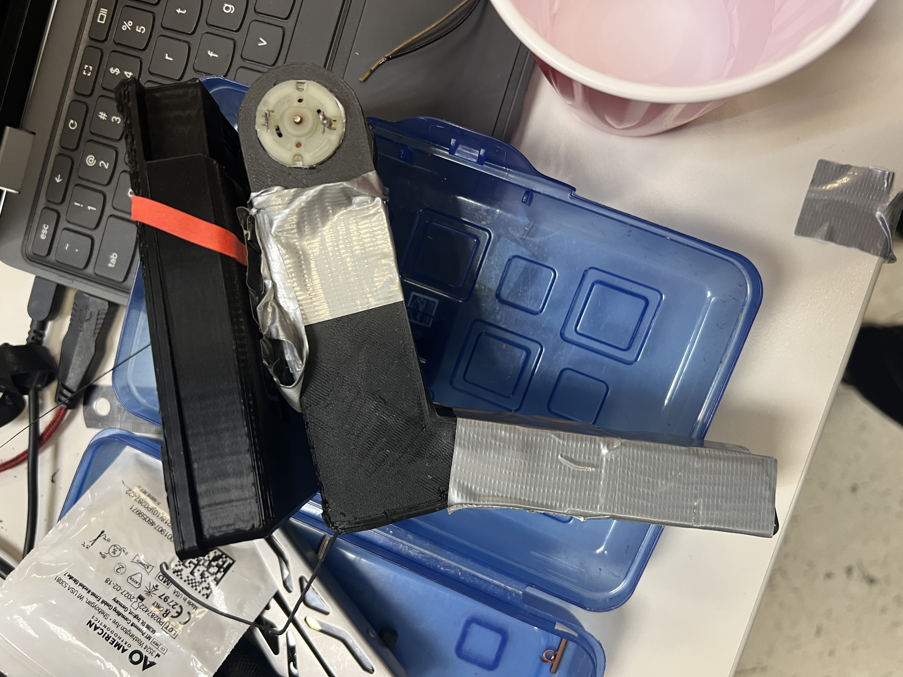

# Card Launcher Prototype

A physical card-launcher prototype documented through a build photograph and demonstration recording.

[View the demonstration video](IMG_9679.mov).

## What is included

- [`IMG_9676.JPG`](IMG_9676.JPG): photograph of the prototype.
- [`IMG_9679.mov`](IMG_9679.mov): project demonstration recording.
- [`test.ino`](test.ino): an Arduino sketch scaffold with empty `setup()` and `loop()` functions.

The photograph shows the physical build, including its printed body and motor. This repository documents the hardware through media; implemented Arduino control logic, CAD files, and a wiring diagram have not yet been added.
